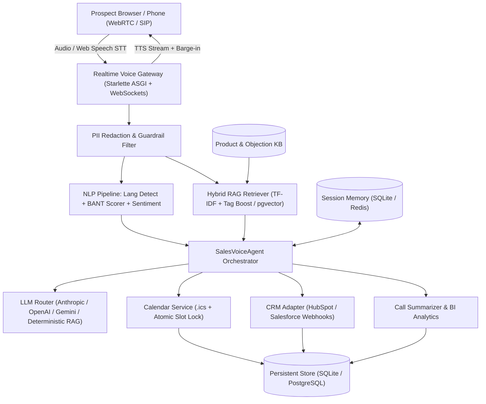
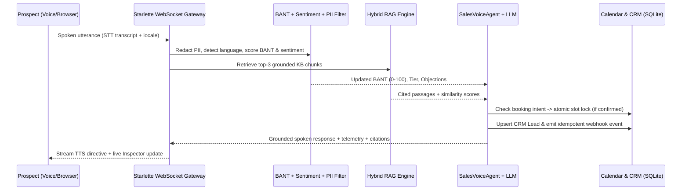

# System Architecture, 100k-User Scalability & Commercial Strategy

## 1. Business Problem & Commercial Feasibility

### The Business Problem
B2B SaaS and high-velocity revenue teams lose **35–50% of qualified inbound pipeline** due to slow speed-to-lead (industry average >4 hours), limited after-hours coverage, high SDR turnover, and manual CRM data entry. Human SDR teams cost **\$6,500–\$8,500/month** per rep and struggle to scale across multiple languages (English, Spanish, Hindi, French, German).

### Solution: NovaFlow AI Autonomous Sales Voice Agent
NovaFlow AI responds to prospects in real time over voice, detects language automatically, qualifies leads via **BANT** (Budget, Authority, Need, Timeline), tracks sentiment and objections live, grounds every product/pricing claim in **RAG citations** to prevent hallucinations, books qualified demos onto Account Executive calendars without double-booking, syncs structured records to CRM webhooks, and generates executive post-call summaries + follow-up emails.

### Commercial Feasibility
- **Target ICP**: B2B SaaS, FinTech, HealthTech, and Global Inside-Sales teams with 500+ monthly inbound leads.
- **Pricing Model**: Starter (\$499/mo), Growth (\$1,499/mo), Enterprise (\$3,500+/mo).
- **Unit Cost vs. Margin**: At \$0.032/voice-minute (Flash LLM + streaming STT/TTS), a 4-minute qualification call costs ~\$0.13 in variable AI compute, yielding **>80% gross margin** on SaaS tiers while delivering **>85% cost reduction** versus manual SDR triage.

---

## 2. System Architecture Diagram

### Real-Time Call Turn & Automated Booking Sequence

---

## 3. Complete End-to-End Business Workflow (Implemented MVP)

1. **Call Initiation (`POST /api/calls`)**: Creates a `CallSession`, initializes a CRM `LeadProfile`, emits a `call.started` webhook, and plays a localized greeting (`en`, `es`, `hi`, `fr`, `de`).
2. **Real-Time Conversation (`/ws/call/{session_id}` or `POST /api/calls/{id}/message`)**:
   - Captures browser voice via Web Speech API STT (with text fallback and `barge_in` interrupt control).
   - Masks sensitive PII (credit cards, SSNs) before persistent turn logging.
   - Incrementally updates **BANT** (`0–100` score, `Hot`/`Warm`/`Cold` tier) and extracts contact entities (name, email, company).
   - Evaluates **Sentiment** polarity (`-1.0` to `+1.0`), buying signals, and objections (`Pricing / Budget`, `Security / AI Trust`, etc.).
   - Retrieves top-3 **RAG citations** with similarity scores.
3. **Automated Appointment Booking**: When booking intent is detected (or via one-click slot selection), reserves an AE slot atomically in SQLite (`UPDATE ... WHERE is_booked = 0` preventing race conditions), generates a downloadable RFC 5545 `.ics` invite, and advances the CRM deal stage to `Demo Scheduled`.
4. **Post-Call Summarisation & Business Insights (`POST /api/calls/{id}/summarize`, `GET /api/insights`)**: Produces an executive summary, recommended subscription tier, next actions, follow-up email draft, and live funnel/objection KPIs.

---

## 4. Scalability Strategy: Supporting 100,000 Users

Assuming **100,000 monthly active sales users / prospects** (~1M calls/month, ~4M voice minutes/month) with a 3–5% peak concurrency ratio (~3,000–5,000 concurrent calls):

1. **Stateless Edge & WebSocket Tier**:
   - Package the Starlette ASGI service into containers running `uvicorn` workers behind Kubernetes **Horizontal Pod Autoscaler (HPA)** triggered by active WebSocket connections and CPU/memory.
   - Deploy across 3 geographic regions (`us-east`, `eu-central`, `ap-south`) using GeoDNS / Anycast edge PoPs so voice RTT stays `< 60ms`.
2. **Low-Latency Distributed Memory**:
   - Replace local SQLite with **Redis Cluster** for active call turn state (`<2ms` read/write) and **PostgreSQL (Primary + Read Replicas)** partitioned by `tenant_id` / `month` for durable call records, CRM leads, and analytics.
3. **Production Vector RAG at Scale**:
   - Upgrade from in-memory `TfidfVectorizer` to **Qdrant** or **PostgreSQL + pgvector (HNSW index)** with tenant-isolated namespaces (`tenant_id` metadata filter) and hybrid BM25 + dense embeddings (`text-embedding-3-small` or `bge-m3`).
4. **Async Event-Driven Integrations**:
   - Offload CRM webhook retries (HubSpot/Salesforce API rate limits), `.ics` email dispatch, and post-call LLM summarization to **Apache Kafka** / **Redis Streams** consumer workers so voice turn latency (`p95 < 500ms`) is never blocked by downstream APIs.
5. **LLM Tiering, Semantic Caching & Circuit Breakers**:
   - Cache frequent FAQ/pricing answers in Redis semantic cache (`cosine > 0.94` -> `<20ms` response, \$0 LLM cost).
   - Route 80% of standard qualification turns to low-latency Flash/Haiku models and escalate only complex enterprise objections to frontier models, backed by automatic multi-provider failover (`Anthropic -> OpenAI -> Gemini -> Deterministic RAG`).

---

## 5. Data Security, Infrastructure, Deployment & Operational Costs

### Security & Compliance Controls
- **Encryption**: TLS 1.3 for all WebSocket/SIP/REST traffic; AES-256 KMS encryption at rest for transcripts, audio, and database backups.
- **Real-Time PII Redaction**: Implemented in `app/nlp/security.py` to mask payment cards and SSNs prior to persistence and LLM auditing.
- **Zero Data Retention (ZDR) & Anti-Hallucination**: Enterprise LLM endpoints configured with ZDR; all pricing/compliance responses grounded in versioned RAG passages with citation audit trails.
- **Access & Compliance**: Multi-tenant RBAC/JWT auth, HMAC-SHA256 signed CRM webhooks with idempotency keys, GDPR right-to-erasure (`DELETE /tenants/{id}/leads/{id}`), SOC 2 Type II audit logging, and automated TCPA call-recording disclosures.

### Estimated Monthly Infrastructure & Operational Costs (Production Cloud)

| Scale Tier | Monthly Volume | Compute (K8s + Redis + Postgres/Qdrant) | Voice AI (STT + Flash LLM + Neural TTS) | Total Est. Monthly Cost | Cost / 4-min Call |
|---|---:|---:|---:|---:|---:|
| **MVP / Pilot** | 1,000 calls (4,000 mins) | \$120 | \$128 | **~\$248/mo** | **\$0.25** |
| **Growth** | 10,000 calls (40,000 mins) | \$480 | \$1,180 | **~\$1,660/mo** | **\$0.17** |
| **100k Users** | 100,000 calls (400,000 mins) | \$3,200 | \$9,800 (with 20% semantic cache) | **~\$13,000/mo** | **\$0.13** |

*(Compare \$13,000/mo for 100,000 automated calls against ~250 human SDRs needed for equivalent 24/7 multilingual throughput at >\$1.5M/mo.)*
