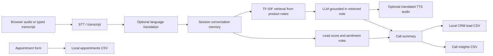
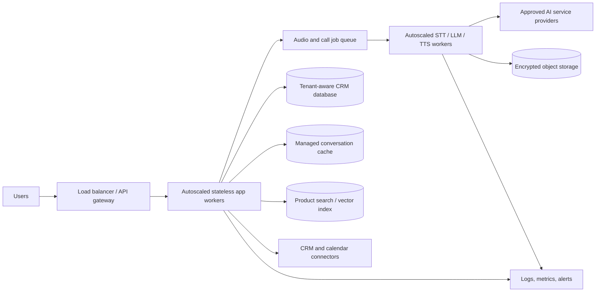

# Autonomous AI Sales Voice Agent (Python prototype)

This Streamlit demo covers all six requested areas at an individual-project scale: turn-based voice input/output, session conversation memory, language translation, lead qualification and sentiment, TF-IDF retrieval from product notes, local appointment/CRM records, and simple call-level business insights.

## Run it

```bash
python3 -m venv .venv
source .venv/bin/activate        # Windows: .venv\\Scripts\\activate
python -m pip install -r requirements.txt
python -m streamlit run app.py
```

Choose a language in the sidebar. Record a short call turn; when recording finishes, the app automatically transcribes it into an editable text box. You can correct that transcript or use the separate **Paste conversation if needed (optional)** box. Pasted text takes precedence if both boxes contain text. Press **Process call turn**, review the answer, lead score, summary, and insights, then use **Book a follow-up meeting** to write an appointment.

For natural, issue-solving answers, create an OpenAI API key and paste it into the password field in the sidebar. The app sends the current transcript, recent session turns, and the retrieved product note to the OpenAI Responses API. Without a key, it falls back to the simpler knowledge-note response. API usage may incur charges. Never paste a key into source code or commit it to Git. The current model setting is `gpt-6-luna` and can be changed in `app.py`.

Try this English transcript: “We have a team of 12, the budget is approved, and we want a demo next month.” Ask “How does the analytics dashboard work?” Then try “How can our team import leads?” to see a different retrieved note. An unrelated question should now get a clear “not in the product notes” answer instead of a random product fact.

## Architecture



### Production scale path (design proposal)



This is the proposed path toward 100,000 registered users, not infrastructure deployed by the prototype. Capacity should be based on tested concurrent calls, since registered users are not all active at once.

## What each feature means in this demo

1. **Voice:** record a turn in the browser; Google-backed speech recognition transcribes it. A Google TTS voice reads the answer. This is turn-based recording, not continuous phone-call streaming.
2. **Context and languages:** the app keeps turns in the current browser session and includes earlier lead turns in retrieval. Optional translation supports English, Hindi, Spanish, French, German, Tamil, and Telugu. Translation and speech require internet access.
3. **Qualification and sentiment:** readable Python keyword rules produce a starter score, buying-signal list, and sentiment label. These are not validated predictive models.
4. **RAG:** TF-IDF and cosine similarity retrieve relevant product notes; when an API key is configured, an LLM uses those notes and session context to write a natural answer. It is instructed to avoid inventing Fortivex features or prices and to say when product information is missing. Without a key, the app returns a simple knowledge-note response.
5. **Booking and CRM:** follow-up appointments and lead records are appended to CSV files in `data/`. These are local stand-ins for real calendar and CRM APIs.
6. **Summaries and insights:** each call creates a summary; the dashboard counts processed calls, high-qualified leads, and positive sentiment from local records.

## Important demo limits

The OpenAI response, speech recognition, translation, and synthesized speech use external services and need internet access. API usage may incur charges. Do not send confidential calls without checking provider terms, obtaining consent, and reviewing security. The local CSV files have no authentication, multi-user isolation, encryption, or automatic deletion. For a real system, use approved vendors, protected storage, a real CRM/calendar connector, human review, and a labeled evaluation set.

See [PROJECT_REPORT.md](PROJECT_REPORT.md) for the one-page business, scaling, and interview summary.
